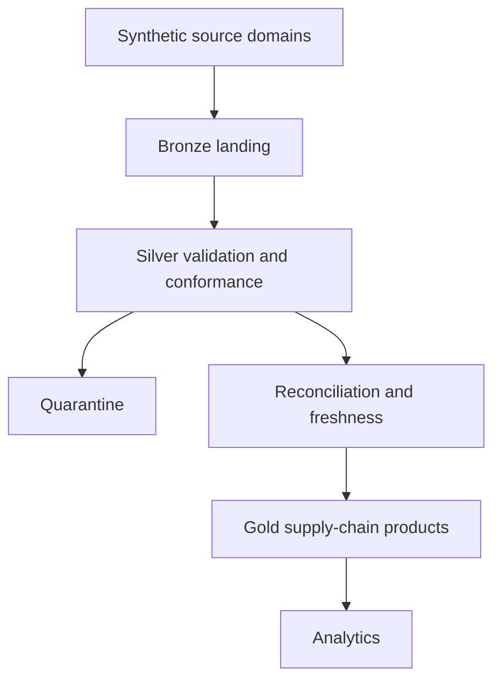

# Manufacturing & Retail Supply Chain Lakehouse

## Status

**NEW BUILD / ACTIVE DEVELOPMENT**

Right now the repository has design notes, a source-contract type, one contract test, CI setup, and empty folders for later work. Databricks jobs, Bronze/Silver/Gold pipelines, Spark benchmarks, and deployment are not built yet.

## Business Problem

Manufacturing, supplier, warehouse, inventory, sales, and return data often come from different systems and do not use the same grain. The planned lakehouse will keep source history, handle late changes, check quantities, and build reporting tables from the combined data.

## Architecture

**State:** Planned batch-first lakehouse

The target stack is Databricks, PySpark, and Delta Lake. The current repository is a design scaffold only.

Maintainable diagram sources:

- [System overview](docs/architecture/system-overview.md)
- [Current scaffold](docs/architecture/current-scaffold.md)
- [Planned Medallion flow](docs/architecture/medallion-flow.md)
- [Planned quality flow](docs/architecture/quality-flow.md)
- [Conceptual ER model](docs/data-model/conceptual-er.md)
- [Proposed logical ER model](docs/data-model/logical-er.dbml)
- [Future streaming architecture](docs/architecture/future-streaming.md)

## Source Systems

Planned synthetic sources represent supplier master, purchase orders and lines, receipts, manufacturing orders and output, warehouse locations, inventory movements and snapshots, retail orders and lines, sales, and returns. Each source contract will define grain, business keys, event time, arrival time, change behavior, and ownership assumptions.

## Data Model

The proposed conformed model separates suppliers, products, plants, warehouses, stores, and customers from purchase-order, production, inventory-movement, sales, and return facts. Surrogate-key and history rules will be documented before transformations are implemented.

## Bronze Layer

Planned Bronze tables preserve source payload, source file or batch identifier, ingestion timestamp, record hash, schema version, and replay metadata. Bronze implementation is pending.

## Silver Layer

Planned Silver processing standardizes types, validates keys, deduplicates records, applies reference checks, separates rejected rows, and produces conformed supply-chain entities. Silver implementation is pending.

## Gold Layer

Planned Gold products cover supplier delivery, purchase-order lifecycle, production output, inventory position and movement, order fulfillment, sales, and returns. Metrics will not be claimed before calculations and reconciliation tests exist.

## Incremental Processing

The roadmap includes batch watermarks, event-time and arrival-time separation, replayable checkpoints, and explicit source-specific incremental rules. No checkpointing implementation exists yet.

## CDC / Delta MERGE

The project will test insert, update, delete, duplicate, and out-of-order change events with idempotent Delta `MERGE` behavior. CDC is planned and not implemented.

## Late Data

Contracts will distinguish accepted lateness, correction windows, quarantine, and downstream restatement. Synthetic late-arrival scenarios will be labeled before the logic is written.

## Idempotency

Every pipeline phase will require a repeat-run invariant based on source identifiers, hashes, and deterministic merge keys. Idempotency evidence is a future test deliverable.

## Backfills

Planned backfills use a fixed source window, separate checkpoints, and reconciliation before publication. No backfill command exists yet.

## SCD Type 2

History-preserving dimensions are planned for selected supplier, product, location, and customer attributes where business questions require as-was reporting. Effective dates, current-row flags, overlap checks, and late corrections remain design work.

## Data Quality

Planned controls include schema, null, uniqueness, reference, domain, chronology, quantity, amount, freshness, and movement-balance checks. Rule severity and publication behavior will be explicit.

## Quarantine

Rejected rows will preserve source payload, rule identifiers, error details, run identifiers, and reprocessing state. No row will be described as corrected unless a tested reprocessing path exists.

## Reconciliation

Planned reconciliation compares source-to-Bronze counts, accepted and rejected totals, purchase-order and receipt quantities, production and inventory movements, sales and returns, and layer-to-layer amounts. Tolerances will be versioned.

## Freshness Monitoring

The design will track expected arrival, latest event time, latest ingestion time, source delay, pipeline delay, and product publication time. No monitoring service is currently implemented.

## Orchestration

Databricks job definitions and dependency gates are planned under `databricks/jobs/`. They will enforce quality and reconciliation results before downstream publication. The directory currently contains design notes only.

## Testing

The initial scaffold tests the source-contract type. Planned tests cover transforms, data quality, reconciliation, reruns, CDC, late data, SCD Type 2, backfills, schema evolution, and full synthetic scenarios.

## Spark Performance Lab

Later tests may compare partitions, file sizes, joins, skew handling, caching, and Delta maintenance with the same data and correctness checks. There are no benchmark results yet.

## Failure Lab

Planned cases include missing batches, duplicates, schema drift, invalid references, partial writes, late changes, checkpoint loss, skew, and failed reconciliation. Each case will define expected safe publication and recovery behavior.

## Analytics

Future Gold tables may support supplier delivery, production, inventory, fulfillment, sales, and return analysis. There is no dashboard or business result yet.

## Future Enterprise AI Extension

After the data products work and can be traced back to source records, a future assistant could search supply-chain evidence or prepare questions. It must not invent data, bypass quality checks, place orders, or change inventory.

## Case Study

[Portfolio case study](https://souravkh-7.github.io/git_portfolio/projects/manufacturing-retail-supply-chain-lakehouse.html)

## Blog

No dedicated project blog post is published yet.
