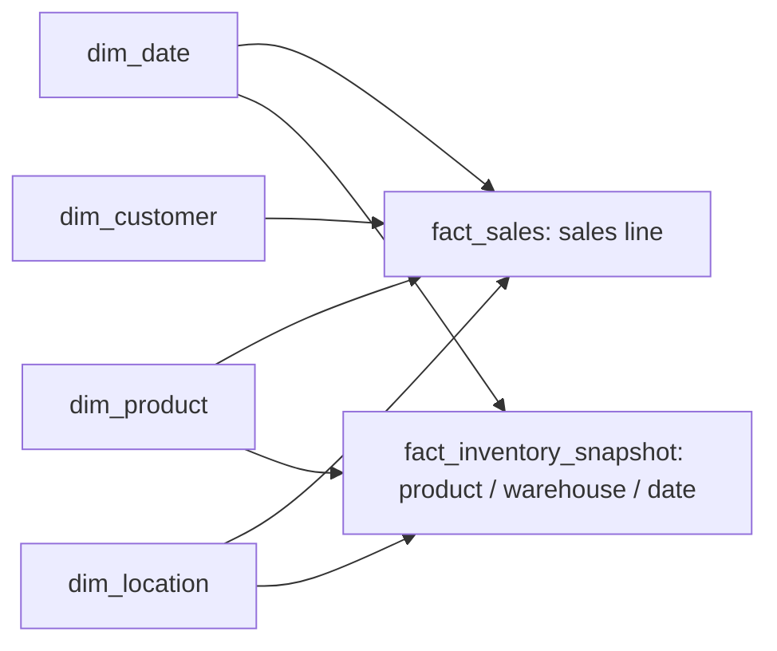
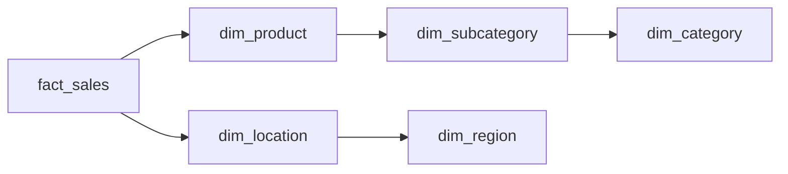

# Dimensional design plan

This design reconciles the earlier Operations Intelligence Lakehouse discussion with this repository. It is a proposed Gold model; physical tables and pipelines are not implemented. The historical v4 ZIP has not been recovered, and this document does not claim to reproduce it.

Bronze/Silver/Gold defines processing and trust stages. Star and snowflake schemas define analytical relationships within curated data.

## Star schema

Use separate fact tables for separate business grains. Do not join facts directly before aggregating them to a shared grain.

| Proposed fact | Grain | Example measures | Dimensions |
| --- | --- | --- | --- |
| fact_sales | One source sales line | quantity, gross amount, discount, net amount | date, product, customer, location |
| fact_inventory_snapshot | One product per warehouse per snapshot date | on-hand quantity | date, product, location |
| fact_inventory_movement | One source movement event | signed quantity | date, product, location |
| fact_production | One manufacturing output event | good quantity, rejected quantity | date, product, location, equipment when present in source |
| fact_receipt | One receipt line against a purchase-order line | received quantity | date, product, supplier, location |

Proposed dimensions are dim_date, dim_product, dim_customer, dim_supplier, dim_location and dim_equipment. Equipment belongs only where a source relationship exists; the present source scaffold does not establish all machine and maintenance relationships from the earlier discussion.

## Snowflake comparison

For a documented comparison, normalize product classification as dim_product -> dim_subcategory -> dim_category, and geography as dim_location -> dim_region. Use stable surrogate keys and explicit foreign keys. Measure query complexity and correctness before choosing this structure; no performance advantage is claimed.

## Keys and history

Retain source business keys and lineage alongside warehouse surrogate keys. Reserve an unknown member for valid late-arriving references; invalid references require quarantine. For selected changing attributes, design SCD Type 2 with effective_from, effective_to and is_current. Use half-open validity intervals, prohibit overlaps, and resolve the dimension key using event time. A correction or backfill must specify whether historical facts are restated.

## Acceptance evidence before implementation claims

- Unique business grain per fact; unique dimension surrogate keys.
- Referential integrity, unknown-member handling and SCD interval tests.
- Reconciliation of source, accepted, rejected and published totals.
- Repeat-run invariants and late-arriving correction scenarios.
- Equivalent star and snowflake query results on the same synthetic scenario.
- Architecture and model diagrams updated to match implemented tables.
